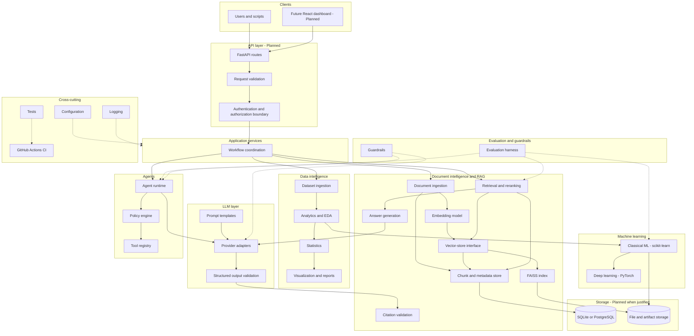
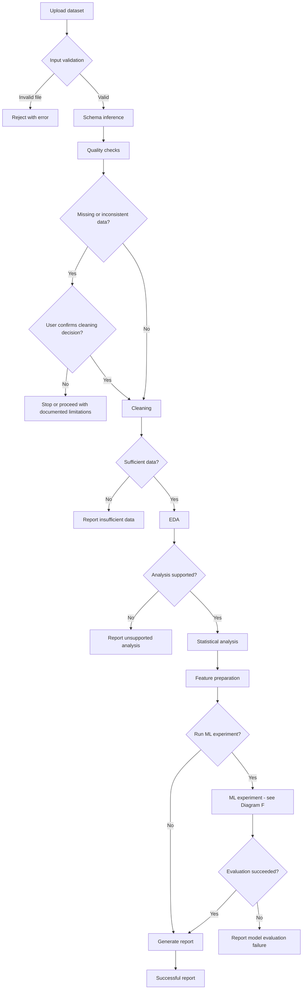
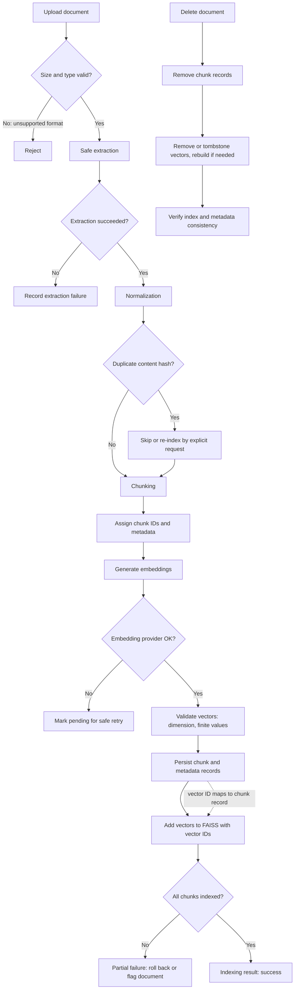
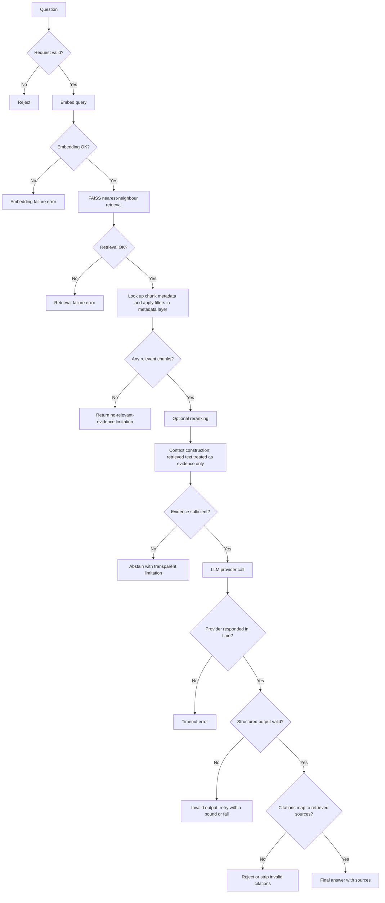
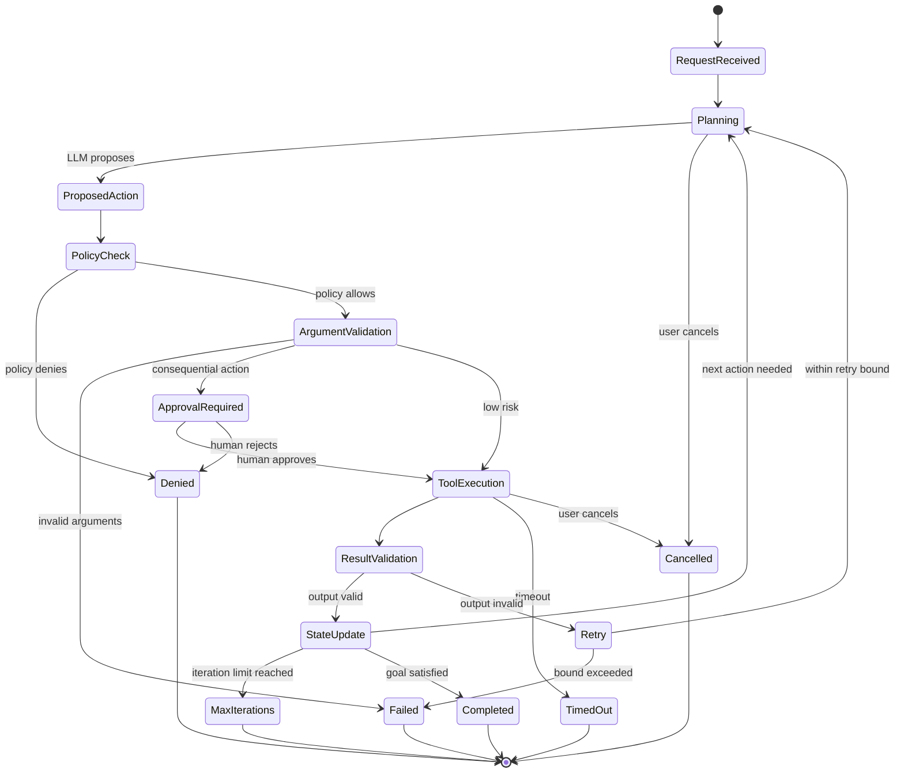
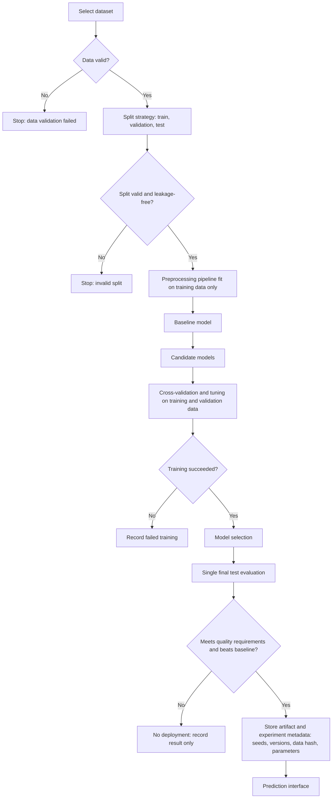
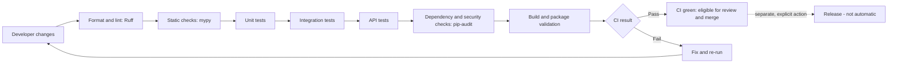
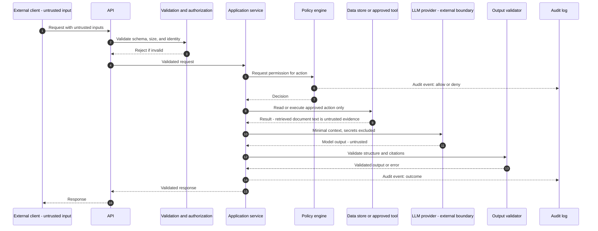

# ORVYNTAL

**A modular, end-to-end AI intelligence platform: from raw data and documents to evidence-backed insights, reproducible models, and policy-controlled AI workflows.**

Repository: <https://github.com/aliashrafabbasi/orvyntal> · Owner: `aliashrafabbasi` · Language: Python · Primary environment: Linux

---

## Project status

> **ORVYNTAL's AI capabilities are in the architectural and planning stage; its initial Python packaging and test foundation have been implemented.** This document describes the intended vision, architecture, and roadmap. Feature statuses must reflect actual implementation and verification evidence. Planned AI components must not be assumed to exist or work.

Status labels used throughout:

| Label | Meaning |
|---|---|
| `Planned` | Designed and documented; no working code. |
| `In Progress` | Code exists but is incomplete or untested. |
| `Implemented` | Code exists and runs, but is not yet covered by adequate automated tests. |
| `Verified` | Implemented and covered by passing automated tests and/or CI, with evidence in the repository. |

There is no deadline or calendar schedule. Work is organized by dependencies and measurable milestones (see [Roadmap](#17-roadmap)).

## Table of contents

1. [Product overview](#1-product-overview)
2. [Problem statement](#2-problem-statement)
3. [Design principles](#3-design-principles)
4. [Core capabilities](#4-core-capabilities)
5. [Technology stack and rationale](#5-technology-stack-and-rationale)
6. [FAISS and RAG responsibility boundaries](#6-faiss-and-rag-responsibility-boundaries)
7. [Architecture diagrams](#7-architecture-diagrams)
8. [Feature-status matrix](#8-feature-status-matrix)
9. [Repository structure](#9-repository-structure)
10. [Storage model](#10-storage-model)
11. [Security and trust model](#11-security-and-trust-model)
12. [Evaluation methodology](#12-evaluation-methodology)
13. [Installation and quickstart](#13-installation-and-quickstart)
14. [Testing](#14-testing)
15. [Contributing](#15-contributing)
16. [Known limitations](#16-known-limitations)
17. [Roadmap](#17-roadmap)
18. [Future directions](#18-future-directions)
19. [License](#19-license)
20. [Project links](#20-project-links)

---

## 1. Product overview

ORVYNTAL transforms raw datasets and unstructured documents into actionable insights, predictive models, evidence-backed answers, and controlled AI-assisted workflows. The long-term goal is to integrate data science, statistics, machine learning, deep learning, LLMs, embeddings, vector search, RAG, agent orchestration, evaluation, and an API into one coherent system.

The platform evolves incrementally from a **maintainable modular monolith**. Services are not split into microservices unless measurement justifies it.

## 2. Problem statement

Practitioners typically juggle disconnected notebooks, ad hoc scripts, and one-off LLM demos. Common failures include:

- Data-quality problems discovered after modelling.
- Evaluation mistakes such as data leakage and repeated tuning against the test set.
- LLM answers with no verifiable source, or with fabricated citations.
- Agents with unrestricted tool access, where the LLM effectively acts as the security authority.
- Impressive demos with no measurements behind them.

ORVYNTAL aims to address these with explicit interfaces, reproducible experiments, validated outputs, application-enforced policy, and documented evaluation.

## 3. Design principles

1. Modular monolith before microservices.
2. Separation of domain logic, application services, infrastructure, and API handlers.
3. Explicit interfaces between subsystems.
4. Reproducible experiments and measurable evaluation.
5. Evidence-backed RAG answers and honest uncertainty.
6. Least-privilege access and policy-controlled tools.
7. Provider independence where practical.
8. Resource-conscious local development (no GPU, CUDA, or paid API required by default).
9. Tests for failure cases, not only success paths.
10. Incremental implementation with working milestones.
11. Versioned API contracts and controlled schema changes.
12. No false claims about implementation status.

Module boundaries are designed for extension without over-engineering the first release.

## 4. Core capabilities

All items below are **planned**.

**A. Data intelligence.** CSV ingestion first, other formats added deliberately; schema inference; missing-value, duplicate, and quality analysis; cleaning; EDA; descriptive statistics; correlation analysis (with correlation-versus-causation caveats); outlier exploration; visualization and reports; feature preparation.

**B. Machine learning.** Classification, regression, clustering; baselines before complex models; reusable pipelines; split management; cross-validation and tuning; model comparison; artifact persistence with controlled loading; prediction workflows; experiment metadata; PyTorch experiments where justified.

**C. Document intelligence and RAG.** Document validation and extraction; normalization and chunking; metadata and source tracking; embeddings; vector indexing and retrieval; optional reranking; context assembly; LLM answer generation; citation validation; insufficient-evidence abstention; retrieval and groundedness evaluation.

**D. LLM layer.** Provider-independent adapters; versioned prompt templates; structured outputs with schema validation; retries, timeouts, and error handling; token, latency, and cost recording where available; prompt-injection awareness; evaluation datasets; mock providers so development needs no paid API.

**E. Controlled agents.** Workflow state; task decomposition; tool registry with strict argument schemas; policy checks before execution; least privilege; bounded iterations and time; human approval for consequential actions; validated outputs; recovery and cancellation; traces and audit events. *The LLM may propose an action; an application-controlled policy layer decides whether it is allowed.*

**F. Backend and future interface.** FastAPI backend first; a React + TypeScript dashboard only after core services and the API are stable.

## 5. Technology stack and rationale

The stack is intended, **not installed or implemented**. Dependencies are added when their subsystem is built.

### 5.1 Dependency categories

| Category | Rule |
|---|---|
| Core initial dependencies | Only what the first functional implementation needs. |
| Planned subsystem dependencies | Added when that subsystem is implemented. |
| Optional / future | Added only when justified by a concrete need. |

### 5.2 Technology table

| Technology | Purpose | Subsystem | Category | Status | Why |
|---|---|---|---|---|---|
| Python | Primary language | All | Core | Planned | Mature ecosystem for data, ML, LLMs, and web APIs. |
| NumPy | Arrays, vectorized math, vector representation | Analytics, ML, vectors | Core | Planned | Foundation for numerical work. |
| Pandas | Tabular ingestion, cleaning, analysis | Analytics | Core | Planned | Standard tabular toolkit. |
| SciPy | Selected statistical and scientific functions | Statistics | Subsystem | Planned | Well-tested statistical routines. |
| Matplotlib | Plotting and report visuals | Analytics | Subsystem | Planned | Foundational, controllable plotting. |
| Seaborn | Statistical visualizations | Analytics | Optional | Planned | Convenience for distribution plots where appropriate. |
| scikit-learn | Preprocessing, classical ML, pipelines, CV, metrics | ML | Subsystem | Planned | Reliable baselines and evaluation tooling. |
| Joblib | Model artifact persistence | ML | Subsystem | Planned | Suited to sklearn objects; loading restricted to trusted artifacts. |
| PyTorch | Neural networks, tensors | Deep learning | Subsystem | Planned | Flexible DL; CPU-friendly defaults; not in initial install. |
| OpenAI API | Hosted LLM provider | LLM | Subsystem | Planned | One possible adapter. |
| Anthropic API | Optional provider adapter | LLM | Optional | Planned | Provider independence. |
| Groq API | Optional provider adapter | LLM | Optional | Planned | Provider independence where supported. |
| Pydantic | Config, schemas, structured-output and tool-argument validation | All | Core | Planned | Typed validation at every boundary. |
| Jinja2 (or equivalent) | Prompt templates | LLM | Subsystem | Planned | Only if templating needs justify it. |
| HTTPX | HTTP clients and API tests | LLM, API | Subsystem | Planned | Sync/async client, test client support. |
| Tenacity (or small in-house retry) | Bounded retries | LLM | Optional | Planned | Avoid hand-rolled edge cases if complexity grows. |
| Sentence Transformers | Local embeddings | Embeddings | Subsystem | Planned | Local, no paid API required. |
| FAISS | Vector indexing and nearest-neighbour search | Vector store | Subsystem | Planned | Initial vector backend behind a project-owned interface. |
| pypdf | PDF text extraction | Ingestion | Subsystem | Planned | Only if PDF support is included. |
| python-docx | DOCX extraction | Ingestion | Optional | Planned | Added only after tests exist. |
| Beautiful Soup | HTML parsing | Ingestion | Optional | Planned | Only if HTML is supported. |
| LangChain | Optional orchestration/integrations | Agents | Optional | Planned | Only where it shows measurable value; never a replacement for security or validation. |
| asyncio | Asynchronous I/O | API, agents | Subsystem | Planned | Where I/O concurrency helps. |
| FastAPI | REST API | API | Subsystem | Planned | Typed routes, OpenAPI generation. |
| Uvicorn | ASGI server | API | Subsystem | Planned | Standard development server. |
| python-multipart | Upload handling | API | Subsystem | Planned | Required if form uploads are used. |
| SQLAlchemy | Relational persistence abstraction | Persistence | Optional | Planned | Added only when persistence has a real use case. |
| PostgreSQL | Relational database | Persistence | Optional | Planned | Planned production-grade store when justified. |
| SQLite | Lightweight dev/test database | Persistence | Optional | Planned | Zero-setup testing. |
| Alembic | Schema migrations | Persistence | Optional | Planned | Only if SQLAlchemy is adopted. |
| pytest, pytest-cov | Tests and coverage | Quality | Core | Planned | Coverage is measured, not asserted. |
| Ruff | Lint and format | Quality | Core | Planned | Single fast tool. |
| mypy | Static typing | Quality | Subsystem | Planned | Where practical. |
| pip-audit | Dependency vulnerability checks | Quality | Optional | Planned | Where compatible. |
| pre-commit | Local quality hooks | Quality | Optional | Planned | Optional convenience. |
| GitHub Actions | CI | Quality | Core | Implemented | Workflow added for tests, lint, and formatting; remote run pending. |
| `logging` (stdlib) | Structured logging conventions | Observability | Core | Planned | No extra dependency. |
| Pydantic Settings, python-dotenv | Typed config, `.env` loading | Config | Optional | Planned | If configuration complexity justifies. |
| OpenTelemetry, Prometheus-compatible metrics | Tracing and metrics | Observability | Future | Planned | Only if required. |
| `pyproject.toml`, venv, pip | Packaging and environment | Tooling | Core | Planned | Single primary install path: venv + pip. |
| uv | Fast environment tool | Tooling | Optional | Planned | Alternative, not required. |
| Docker, Docker Compose | Reproducible packaging, multi-service dev | Tooling | Future | Planned | Only when justified. |
| React, TypeScript, Vite, charting library | Dashboard | Frontend | Future | Planned | Built only after core and API stabilize. |

### 5.3 Role of the mathematical foundations

- **Numerical computing (NumPy):** vectorized operations underpin analytics, feature matrices, and embedding vectors.
- **Data manipulation (Pandas):** ingestion, cleaning, and transformation of tabular data.
- **Probability and statistics (SciPy):** distributions, hypothesis tests, uncertainty, and honest interpretation of results.
- **Linear algebra:** underlies similarity search, dimensionality reduction, linear models, and neural networks.

### 5.4 ML evaluation discipline

Baseline models (for example a majority-class predictor or a regularized linear model) come before complex architectures, because a complex model is only meaningful if it beats a sound baseline. Training, validation, hyperparameter tuning, and final test evaluation are strictly separated. Preprocessing is fit on training data only and applied through pipelines to avoid leakage. The test set is not used repeatedly for tuning.

### 5.5 Dependency rules

- Provider SDKs are optional and isolated; the platform must not depend on a single vendor.
- Provider-specific dependencies are added when their adapters are implemented.
- The foundation must not require a paid API, a GPU, or CUDA to run tests.
- Avoid duplicate libraries doing the same job without clear reason.
- Choose one primary installation path (venv + pip) and document it.

## 6. FAISS and RAG responsibility boundaries

FAISS is the **initial vector backend**, used behind a project-owned vector-store interface so another backend can be integrated without rewriting the RAG application layer.

| Step | Responsible component |
|---|---|
| 1. Extract content | Document parsers |
| 2. Divide text into retrieval units | Chunking logic |
| 3. Convert chunks and queries to vectors | Embedding model |
| 4. Index vectors and retrieve nearest candidates | FAISS |
| 5. Map vector IDs to chunk text, source metadata, document identity | Separate metadata/document store |
| 6. Assemble relevant evidence | Retrieval layer |
| 7. Generate an answer from retrieved context | LLM (optional) |
| 8. Verify claimed references map to retrieved sources | Citation validation |

**What FAISS is not:** a document parser, an embedding model, an LLM, or a metadata database. By itself it does not provide persistent metadata filtering, multi-user authorization, or database transactions; those responsibilities belong to the surrounding components.

Index choice: begin with a flat index for small local experiments and choose the similarity metric deliberately. If cosine similarity is implemented via inner product, vectors must be L2-normalized. Approximate indexes are introduced only when scale and measurements justify them.

Initial formats: a deliberately small set (plain text, Markdown, and PDF if feasible). Each parser gets tests before further formats are added. Chunk size, overlap, embedding model, retrieval parameters, reranking, re-indexing, and deletion behaviour are configurable and documented as they are implemented. Perfect retrieval and hallucination-free answers are **not** promised.

## 7. Architecture diagrams

Diagrams show the **intended** architecture. Unless stated otherwise, every component is `Planned`.

### Diagram A: Complete system architecture



**What it represents.** All intended subsystems and their relationships.
**Responsibilities.** The API layer validates and authorizes requests; application services coordinate workflows; analytics and ML handle tabular data; the LLM layer isolates providers; the RAG subsystem owns documents, embeddings, vectors, and citations; the agent runtime proposes actions while the policy engine authorizes them.
**Validation and policy.** Request validation and authorization occur at the API boundary; structured-output and citation validation follow LLM calls; the policy engine gates every tool call.
**Failures.** Failures return typed errors to the caller; no partial state is treated as success.
**Status.** Everything shown is `Planned`. Databases and the dashboard are added only when a real use case exists.

### Diagram B: Dataset intelligence pipeline



**Represents.** The path from uploaded data to a deterministic report.
**Responsibilities.** Ingestion validates and infers schema; analytics detects quality issues; cleaning is applied only with explicit rules or user confirmation where decisions alter data meaning.
**Validation.** File checks first, then schema and quality checks, then sufficiency and support checks.
**Failures.** Each branch ends in an explicit, explained outcome rather than a silent default. Cleaning decisions are recorded in the report.
**Status.** `Planned`.

### Diagram C: Document ingestion and FAISS indexing



**Represents.** How a document becomes searchable, including deletion.
**Responsibilities.** Parsers extract; chunking splits; the embedding model produces vectors; FAISS stores vectors; a **separate** metadata store keeps chunk text and provenance keyed by vector ID.
**Validation.** Size/type checks, extraction checks, vector validation (dimension, finite values).
**Failures.** Embedding failures leave the document in a retryable state; partial indexing is rolled back or flagged; reprocessing must be idempotent. Some FAISS index types do not support cheap removal, so deletion may require tombstones or a rebuild, and consistency checks are required.
**Status.** `Planned`.

### Diagram D: RAG query lifecycle



**Represents.** A question flowing to a cited answer or a transparent refusal.
**Responsibilities.** FAISS returns candidate IDs; the metadata layer resolves and filters them; the LLM only sees assembled context; citation validation checks references against the actually retrieved chunks.
**Validation.** Request, structured output, and citation checks.
**Failures.** When evidence is insufficient the system abstains instead of inventing sources. Provider failures return explicit errors.
**Status.** `Planned`. Groundedness is measured, not assumed.

### Diagram E: Controlled AI agent state machine



**Represents.** The lifecycle of a bounded agent run.
**Responsibilities.** The LLM only produces *proposals*. The **policy engine**, not the LLM, grants or denies permission. Argument and output validation use strict schemas.
**Validation and policy.** Policy check, then argument validation, then optional human approval, then execution, then result validation.
**Failures.** Denied actions never execute. Timeouts, cancellation, retry bounds, and iteration limits each end in a distinct recorded terminal state. Every transition emits an audit event.
**Status.** `Planned`.

### Diagram F: Machine learning experiment lifecycle



**Represents.** A reproducible experiment from dataset to prediction.
**Responsibilities.** Preprocessing lives inside pipelines fit on training data only. Tuning uses validation or cross-validation; the test set is evaluated once at the end and **never** used repeatedly for tuning.
**Failures.** Invalid splits, failed training, and unacceptable quality all stop promotion; results are still recorded.
**Safety.** Artifacts are loaded only from trusted storage.
**Status.** `Planned`.

### Diagram G: Development and CI workflow



**Represents.** Automated quality gates.
**Responsibilities.** Each stage fails fast and blocks the next.
**Important.** A green CI run is **not** a release and does **not** imply production deployment. No automatic deployment exists or is implied.
**Status.** `Planned`.

### Diagram H: Trust boundaries and request sequence



**Represents.** Where trust changes along a request.
**Responsibilities.** Validation precedes any processing; the policy engine decides permissions independently of the LLM; secrets are never placed in model context or logs; model output is validated before reaching the client.
**Untrusted:** user inputs, retrieved document text, dataset cells, model output. **External boundary:** LLM providers.
**Failures.** Validation, policy, or output-validation failures return errors and are audited.
**Status.** `Planned`.

## 8. Feature-status matrix

| Component | Planned capability | Status | Verification |
|---|---|---|---|
| Foundation | Minimal Python packaging and automated tests | Implemented | Local verification: 2 pytest tests, Ruff lint, and Ruff formatting pass; clean-checkout verification pending |
| Analytics | Data profiling and EDA | Planned | Analytics fixtures |
| Statistics | Descriptive and inferential analysis | Planned | Statistical tests |
| ML | Training and evaluation | Planned | ML tests |
| Deep learning | CPU-friendly PyTorch experiment | Planned | Training tests |
| LLM layer | Provider interface, structured output | Planned | Mock-provider tests |
| Embeddings | Text embedding generation | Planned | Embedding tests |
| Vector search | FAISS indexing and retrieval | Planned | Retrieval tests |
| RAG | Evidence-backed answers | Planned | Citation and evaluation tests |
| Agents | Policy-controlled tools | Planned | Permission tests |
| API | FastAPI endpoints | Planned | API tests |
| Persistence | Relational metadata store | Planned | Integration tests |
| CI | GitHub Actions workflow for tests, lint, and formatting | Implemented | Workflow file added; local tests, Ruff, and package build pass; workflow validation and GitHub Actions run pending |
| Dashboard | React and TypeScript UI | Planned (future) | None |

Statuses change only with evidence from real files, tests, and workflows.

## 9. Repository structure

### Current structure

The repository contains the canonical `README.md`, Python package metadata in `pyproject.toml`, the `src/orvyntal/` package, and automated tests under `tests/`. The initial foundation is intentionally minimal. A GitHub Actions workflow for Cluster 0.6 is present; workflow-specific validation and a successful remote run remain pending.

### Proposed future structure (illustrative, not existing)

```text
orvyntal/
├── README.md
├── pyproject.toml
├── .gitignore
├── .env.example
├── LICENSE                # not yet chosen
├── CONTRIBUTING.md
├── SECURITY.md
├── docs/
│   ├── architecture/
│   ├── decisions/
│   └── diagrams/
├── src/
│   └── orvyntal/
│       ├── config/
│       ├── api/
│       ├── application/
│       ├── domain/
│       ├── ingestion/
│       ├── analytics/
│       ├── statistics/
│       ├── ml/
│       ├── deep_learning/
│       ├── llm/
│       ├── embeddings/
│       ├── vectorstore/
│       ├── rag/
│       ├── agents/
│       ├── policies/
│       ├── evaluation/
│       ├── persistence/
│       └── observability/
├── tests/
│   ├── unit/
│   ├── integration/
│   ├── fixtures/
│   └── e2e/
├── examples/
├── scripts/
└── .github/workflows/
```

Directories are created only when there is working code for them; empty modules are not added for appearance.

### Dependency direction

```text
api  →  application  →  domain
              ↓
        infrastructure adapters (llm, vectorstore, persistence, embeddings)
```

Domain logic must not import FastAPI, FAISS, a specific LLM provider, or a database implementation. Infrastructure implements interfaces defined by the inner layers.

| Package | Purpose |
|---|---|
| `domain` | Core entities and rules; no framework dependencies |
| `application` | Use cases and workflow coordination |
| `api` | HTTP routes and schemas |
| `ingestion`, `analytics`, `statistics` | Dataset loading, profiling, EDA, statistics |
| `ml`, `deep_learning` | Pipelines, experiments, artifacts |
| `llm` | Provider interface, adapters, prompts, structured output |
| `embeddings`, `vectorstore`, `rag` | Embedding interface, vector-store interface and FAISS adapter, retrieval and citations |
| `agents`, `policies` | Runtime, tool registry, and policy engine |
| `evaluation` | Metrics and evaluation harnesses |
| `persistence` | Metadata, chunk, and artifact storage |
| `observability` | Logging and optional tracing |

## 10. Storage model

| Store | Holds | Notes |
|---|---|---|
| Relational metadata (SQLite or PostgreSQL) | Users, jobs, experiment records, document records | Added only when a use case requires it |
| Document/chunk store | Chunk text, source metadata, document identity, vector-ID mapping | Separate from the vector index |
| Vector index (FAISS) | Embedding vectors only | Rebuildable from chunk store plus embeddings |
| Model artifacts | Serialized models plus metadata | Loaded only from trusted storage |

## 11. Security and trust model

Controls below are **planned** and must be validated with tests; nothing here is a claim of perfect security.

- Uploaded files, prompts, retrieved documents, and dataset cells are **untrusted input**.
- Validate file size, content type, encoding, schema, and request limits.
- Never execute uploaded scripts, embedded code, shell commands, or macros.
- Prevent path traversal; use safe temporary-file handling.
- Keep credentials out of source control; provide `.env.example` with placeholders and keep `.env` uncommitted.
- Enforce permissions independently of the LLM; validate tool arguments and outputs.
- Apply bounded loops, timeouts, resource limits, and quotas.
- Treat retrieved text as evidence, not instructions; consider direct and indirect prompt injection.
- Avoid exposing secrets or unrelated documents in model context.
- Validate citations and structured outputs.
- Limit sensitive content in logs; never log secrets or API keys.
- Require explicit approval for consequential or irreversible actions.
- Do not trust arbitrary serialized model files; load only trusted artifacts.
- Authentication, authorization, and multi-user isolation are **requirements before any multi-user deployment**.
- Never give an LLM unrestricted shell, filesystem, database, network, or OS access.

## 12. Evaluation methodology

No scores, coverage numbers, or benchmarks are claimed. All metrics must be measured on documented test sets.

| Area | Measured |
|---|---|
| Data analytics | Schema validation success, quality-issue detection, reproducibility, handling of missing or invalid input |
| ML / DL | Precision, recall, F1, ROC-AUC (classification); MAE, RMSE (regression); baseline comparison; split correctness; leakage prevention; reproducibility; artifact integrity |
| Embeddings / RAG | Ranking metrics where labels exist; context relevance; citation validity; faithfulness and groundedness; abstention quality; latency and failure rate |
| Agents | Task completion on defined cases; valid tool-call rate; correct authorization denial; timeout and iteration-limit enforcement; tool-output validation; auditability |
| API / operations | Latency, error rates, validation failures, test results, resource usage |

## 13. Installation and quickstart

**Initial development setup** (Python 3.12+ and `uv` required):

```bash
uv venv
uv pip install --python .venv/bin/python -e '.[dev]'
.venv/bin/python -m pytest -q
.venv/bin/ruff check .
.venv/bin/ruff format --check .
```

The package and these foundation checks have previously passed locally. Re-run them after changes; this does not imply that the future AI capabilities are implemented. Keep the initial install lightweight, defer PyTorch, provider SDKs, and databases until their relevant clusters, and document credential or network requirements when introduced.

## 14. Testing

Current quality baseline: `pytest` for automated tests and Ruff for linting and formatting. The initial package tests require no paid API, private dataset, GPU, or external service. GitHub Actions CI is being introduced in Cluster 0.6. `mypy` and `pytest-cov` are future options, not currently configured checks; coverage must not be reported until measured.

## 15. Contributing

ORVYNTAL is developed through dependency-ordered milestones, each divided into
small, verifiable clusters. A milestone plan defines its purpose, dependencies,
clusters, interfaces, resource constraints, risks, and release gate before
implementation begins.

### Engineering hierarchy

**Milestone → Cluster → Task → Test → Acceptance criteria**

- **Milestone:** a coherent capability or engineering outcome with an explicit
  integration and completion gate.
- **Cluster:** a bounded unit of work with defined scope, dependencies,
  contracts, risks, tests, and measurable acceptance criteria.
- **Task:** a small implementation or verification action within one cluster.
- **Test:** repeatable evidence that specified behaviour and failure cases work.
- **Acceptance criteria:** observable conditions that must pass before a cluster
  can be marked complete.

### Cluster lifecycle

1. Inspect the repository, current interfaces, Git state, and relevant tests.
2. Define the cluster scope, non-goals, dependencies, contracts, and acceptance
   criteria before editing.
3. Implement the smallest coherent patch; avoid unrelated refactors.
4. Review the diff for correctness, compatibility, security, and scope.
5. Run the available targeted tests and quality checks; add tests when the
   cluster introduces testable behaviour.
6. Verify acceptance criteria and record any limitations or deferred work.
7. Integrate completed clusters at the milestone gate; verify cross-cluster
   behaviour before declaring the milestone complete.

A cluster passing its own tests does not automatically complete its milestone.
A milestone requires integration checks, regression checks, documentation
review, and its stated release criteria.

### Repository and compatibility rules

- Use branch-based development and small, focused commits; run the configured
  formatting, linting, and relevant tests before requesting commit approval.
- Inspect before changing files; preserve existing architecture decisions unless
  evidence justifies a documented change.
- Keep domain logic independent of API frameworks and infrastructure adapters.
- Add dependencies only when a specific cluster needs them; prefer lightweight,
  CPU-first development and deterministic tests that need no paid API.
- Do not claim a feature is implemented or verified without repository evidence.
- Preserve existing interfaces by default. API, schema, or behavioural
  incompatibilities require an explicit migration and versioning plan.
- Never commit secrets, private datasets, generated caches, or local runtime
  artifacts.
- Avoid broad staging commands such as `git add .` and `git add -A`; stage
  only explicitly reviewed paths.
- Do not create commits or push changes without the user's explicit approval.
- Keep patches focused and reversible; do not perform destructive cleanup or
  rewrite unrelated history without approval.
- Update documentation alongside implementation, and record significant
  architectural decisions when the relevant structure exists.
- If a required check cannot run, report it as unverified rather than implying
  success.

### Local resource policy

The primary development target is a CPU-only laptop with four logical CPU
threads and approximately 16 GiB RAM. Keep the foundation lightweight. Do not
install PyTorch, vector databases, provider SDK collections, or external
services before the cluster that needs them. Prefer mocks and small deterministic
fixtures; document any optional network, credential, or hardware requirements.

### Cluster definition of done

A cluster is complete only when its agreed scope is implemented, its diff is
reviewed, relevant checks pass, acceptance criteria are satisfied, documentation
is accurate, and unresolved limitations are recorded. Completion does not
authorize a commit or push.

### Security reporting

Never commit secrets or private datasets. Until a dedicated `SECURITY.md`
exists, report security concerns privately through the repository owner's
GitHub contact route.


## 16. Known limitations

- No functional implementation is verified yet; this document describes intent.
- RAG cannot guarantee perfect retrieval or eliminate hallucinations.
- FAISS alone provides no metadata filtering, authorization, or transactions.
- No authentication or multi-user isolation exists.
- Initial format support will be deliberately narrow.
- No license has been chosen.

## 17. Roadmap

The roadmap is dependency-ordered, not calendar-driven. Milestones are completed
only when their acceptance gates have repository evidence. Clusters are planned
and verified independently; the milestone gate checks their integration.

### Milestone 0 — Engineering foundation

**Goal:** establish a maintainable, testable, reproducible project baseline
before building AI capabilities.

| Cluster | Scope | Acceptance criteria |
|---|---|---|
| 0.1 Repository audit | Inspect Git state, tracked files, project identity, and documentation baseline; identify and remove the redundant README duplicate | Canonical README preserved; repository state and diff verified; no unrelated files changed |
| 0.2 Documentation and workflow | Document milestone/cluster hierarchy, lifecycle, safety rules, and completion gates | Roadmap and contributing guidance agree; current status is factual; Markdown and Mermaid structure remain intact |
| 0.3 Python packaging | Choose the supported Python range and minimal `pyproject.toml` metadata; define dependency groups only as justified | Clean environment can install the base project; declared metadata and dependency policy are validated |
| 0.4 Structure and Git hygiene | Introduce only necessary source/test directories and appropriate ignore rules | Package layout is importable; generated files and secrets are excluded; unrelated local files remain untouched |
| 0.5 Test and quality baseline | Add lightweight test configuration and focused quality tooling | Deterministic tests run locally; configured checks have documented commands; failures are actionable |
| 0.6 Continuous integration | Add a minimal CI workflow for the supported Python environment | CI checks out a clean repository and runs the agreed quality checks successfully |

**Milestone 0 integration gate:** verify packaging from a clean checkout, run
all foundation tests and configured quality checks, inspect the complete diff,
and confirm that setup instructions match the repository. No AI feature is
required to pass this milestone.

### Subsequent milestones

| Milestone | Dependencies | Scope | Completion gate |
|---|---|---|---|
| 1. Data intelligence and statistics | Milestone 0 | CSV ingestion, validation, profiling, EDA, descriptive statistics, deterministic reports | Valid and invalid inputs are tested; repeatable inputs produce reproducible outputs |
| 2. Classical machine learning | Milestone 1 | Preprocessing, baselines, classification/regression/clustering, evaluation, experiment metadata, artifact handling | Seeded reproducibility and leakage safeguards are tested; candidates are compared with baselines |
| 3. CPU-first deep learning | Milestone 2 | A scoped PyTorch experiment, training loop, evaluation, and resource limits | CPU execution is verified and results are compared with a classical baseline |
| 4. LLM foundation | Milestone 0 | Provider interfaces, prompts, structured-output validation, mock provider, timeout/error handling, usage metadata | Tests pass without network access, credentials, or a paid API |
| 5. Document intelligence and RAG | Milestones 0 and 4 | Document validation, extraction, chunking, metadata, embeddings, FAISS retrieval, citations, groundedness evaluation | Retrieval metrics are measured on a labelled set; citation checks pass; insufficient evidence triggers abstention |
| 6. Controlled agents | Milestone 4 | Workflow state, typed tool registry, policy checks, bounded execution, approval, audit traces | Denied actions never execute; permissions and execution limits are tested |
| 7. API and persistence | Milestones 1–6 as needed | FastAPI endpoints, versioned schemas, justified persistence, error handling | API contracts and integration tests pass; migrations are documented where needed |
| 8. Integration and release | Relevant prior milestones | Cross-module regression, security tests, examples, documentation, release preparation | Clean-checkout examples run; release checks and documented acceptance gates pass |

Milestones may proceed independently only when their stated dependencies and
interfaces permit it. The release gate verifies the integrated system rather
than assuming that individually passing clusters guarantee end-to-end behaviour.


## 18. Future directions

Only when justified: additional document formats, more vector backends, more LLM providers, advanced reranking, experiment tracking, robust job processing, authentication and multi-user isolation, a web dashboard, containerized deployment, advanced observability, dataset versioning, and richer evaluation harnesses. None of these exist today.

## 19. License

**No license has been chosen**, and no `LICENSE` file is assumed to exist. Until one is added, all rights are reserved by default under applicable law.

## 20. Project links

- Repository: <https://github.com/aliashrafabbasi/orvyntal>
- Owner: [aliashrafabbasi](https://github.com/aliashrafabbasi)